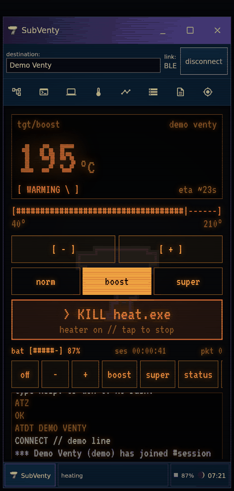
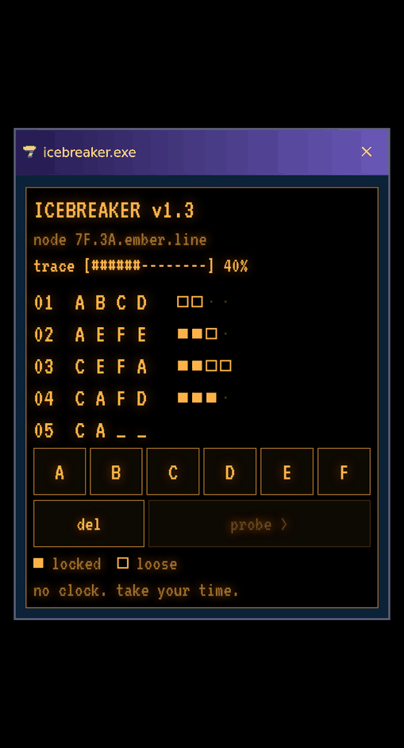
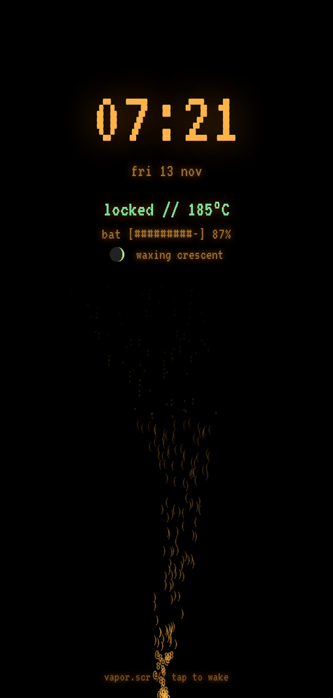

# SubVenty

A native Android companion for the Storz & Bickel Venty and Volcano Hybrid, with the visual language of the SubSeven clients. Built on [orth4x0r/venty-android](https://github.com/orth4x0r/venty-android).

This branch contains the **native Android app**, plus the earlier browser design studies. The Android interface is Kotlin/Jetpack Compose, not a WebView.

## Next: after hours (iteration 3, source only)

<p align="center">  </p>

The client now runs on a CRT at midnight. It has a phosphor terminal home with real controls and a command line, dial-up and IRC-style event narration, a taskbar with a clock and moon phase, and a `vapor.scr` nightstand screensaver. **ICEBREAKER**, an untimed code-cracking puzzle, pulls lore files from a fictional 1999 BBS. The game layer never reads or rewards sessions, and sound is off by default. This iteration is **not built yet**: install preview 2 below until preview 3 is published. Details, renders and verification are in the [iteration 3 notes](docs/native-preview/iteration3/README.md).

## Try the Android app

1. On your Android phone, [download SubVenty preview 2](https://github.com/thehillbeyondthisone/venty-android-umbrella/blob/builds/subventy-preview2/subventy-0.4.0-preview2.apk?raw=true). If GitHub shows the file page, tap **Download raw file**.
2. Open the downloaded APK. Android may ask you to allow installs from the browser or Files app you used.
3. Launch **SubVenty**. Try **Demo Venty** or **Demo Volcano** first. Demo entries are labeled and stored separately from hardware entries.
4. For a real device, allow Nearby devices/Bluetooth access, enable Bluetooth, select **Scan for devices**, then select your Venty or Volcano.

The [build-artifact branch](https://github.com/thehillbeyondthisone/venty-android-umbrella/tree/builds/subventy-preview2) contains the APK and checksum. The binary is kept off the implementation branch. GitHub rejected release-asset uploads for the current integration, so this branch supplies the download.

Preview 2 is version **0.4.0-subventy.2** (code 10). It uses the same application ID and signing certificate as preview 1: install it as an update to retain your local archive and preferences. You do not need to uninstall first.

Android 8.0+ is required. This preview uses a separate application ID (`io.github.thehillbeyondthisone.subventy`), so it can coexist with the upstream Venty app. Close/disconnect the other controller before connecting SubVenty to the same physical device.

You do **not** need to merge the PR, install Android Studio, or build anything yourself to install the APK. On GitHub, HTML files show their source; they do not launch the native app.

## Included in preview 2

- Lavender caption strip, blue connection row and icon toolbar, expandable tree navigation, charcoal workspace, embossed S7 badge, silver pixel-edged seven and segmented status strip. The layout follows the newer user-supplied SubSeven/Legacy references; the earlier 1999 browser reconstruction remains available separately.
- Matching square utility windows for ramps, device properties, Find My, note editing, client options, navigation and About. The title-bar controls minimize the app, expand the workspace and close the client window.
- Native permission, scan, connect, reconnect and disconnect flows using the existing BLE controller.
- Device-confirmed target/readiness, Venty battery, and Volcano live temperature.
- Heater, bounded temperature adjustments, presets, Venty normal/Boost/Superboost, and Volcano pump.
- Themed ramp editor with validated drafts, saved plan and profile loading. Loading/saving a plan leaves heating unchanged; **start ramp and heater** is a separate explicit action.
- Themed device properties for temperature units, boost offsets, eco settings, brightness, vibration and boost timeout where supported. Find My provides Bluetooth signal readings and the existing vibration/flash command. A link monitor displays actual controller events.
- Searchable session and note archives, a dedicated note editor, and JSON export through Android's save-file picker. Export includes all devices, demo records and notes. Import is not implemented.
- **Legacy controls** retains the original advanced dashboard for additional tools and settings. That panel keeps its earlier styling.
- Permanent, local per-device collection archive: reached 5 °C Atlas bands, an Ember Trail, editable one-line notes, and a dismissible weekly postcard.
- **Do not track** pauses new session and battery logs while preserving existing notes/stamps/beads. Resume does not backfill a paused period; a hot session interrupted by a pause is excluded. Device controls continue working. On a new connection, recording waits for an observed heater-off state.
- Demo sessions have separate archive identities. No synthetic example collections are preloaded into the native app.

Atlas stamps use **device-reported reached targets**, not optimistic slider edits. Venty does not report live temperature, so the interface never presents a simulated measurement as a real one. Existing collection records survive the rolling 500-entry recent-session history limit. Notes and collections persist across app restarts; clearing Android app data/uninstalling deletes this local data.

## Scope and validation

This is a native test APK. Compilation, **116 unit tests**, and Android lint pass locally. Android 15 emulator checks cover installation/update, demo connection, target adjustment, heater controls, toolbar/tree navigation, utility windows, workspace expansion and archive export. Screenshots and detailed results are in [the preview 2 notes](docs/native-preview/iteration2/README.md). Physical Bluetooth, manufacturer-specific firmware behavior, watch integration and real-phone ergonomics still need device testing.

The APK is debug-signed for personal testing. Keep the signing key for future compatible updates; do not publish it in the repository. The in-app updater points to **this fork**, not the upstream release feed. Draft/prerelease builds are installed manually.

Passive achievements, Dial-in comparisons, calendar palettes, optional user-chosen chimes, and easter eggs remain in the [design brief](docs/design-exploration/README.md); they are not implemented in this preview. There are no new push reminders, streaks, rankings, or consumption goals.

## Build locally (optional)

Use Android Studio with Android SDK 36 and JDK 17:

```sh
./gradlew :app:testDebugUnitTest :app:lintDebug :app:assembleDebug
```

The APK is `app/build/outputs/apk/debug/app-debug.apk`. The existing GitHub Actions workflow remains manual-only; no workflow runs are required for this preview.

## Design references

- [SubVenty source references](docs/design-exploration/subventy/SOURCES.md): original screenshots, historical Delphi form geometry, colours, and fidelity notes.
- [Interactive browser reconstruction](docs/design-exploration/subventy/index.html).
- [Earlier handwritten/cassette/sculptural studies](docs/design-exploration/style-studies.html).
- [Collection mechanics and plan](docs/design-exploration/README.md).
- [BLE protocol reference](docs/PROTOCOL.md).

## Credits and license

The original Venty/Volcano controller, services, session tools and advanced interface are from [orth4x0r/venty-android](https://github.com/orth4x0r/venty-android), under the [MIT license](LICENSE). The SubVenty UI is an independent implementation of the referenced historical visual design; no SubSeven runtime is included. Not affiliated with Storz & Bickel. Device names are their trademarks.
