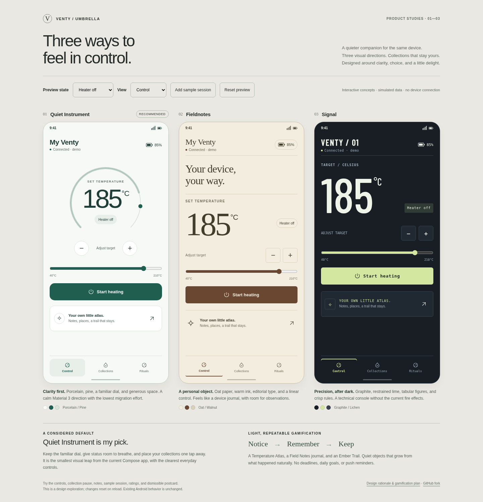
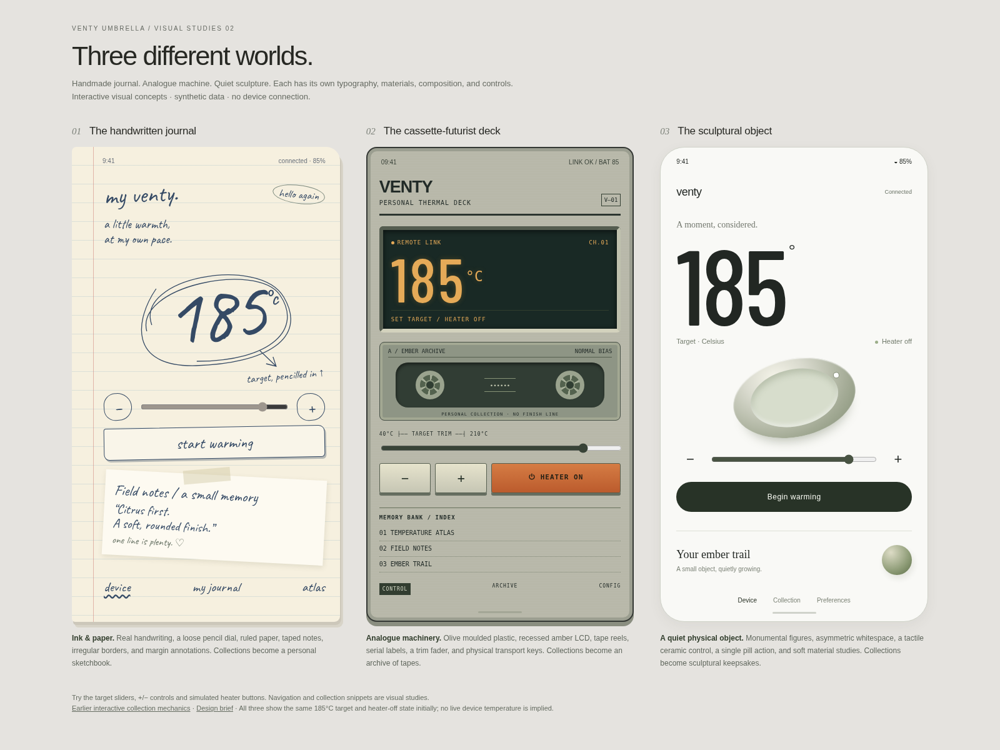

# Venty Umbrella: visual directions and light gamification

Serve [style-studies.html](style-studies.html) locally for three distinct visual styles, or [index.html](index.html) for collection mechanics (instructions below). No build, account, or hardware is needed. The preview uses synthetic data and resets on reload. It does not send device commands or change the Android app.

[View Collections](collections-options.png) · [View all three collection types](collection-types.png) · [View repeatable rituals](rituals-options.png).

## Visual styles

Open [the distinct style studies](style-studies.html) for the current visual comparison. Typography, materials, composition, control shapes, and collection presentation change together.

| Direction | Visual language | Control treatment | Collection treatment |
| --- | --- | --- | --- |
| **Handwritten journal** | Bundled Caveat handwriting, ruled paper, blue ink, irregular outlines, taped notes | Pencil-drawn target circle, handwritten action, small ink-ring adjustments | A sketchbook: handwritten tasting notes, stamped Atlas pages, a drawn Ember Trail |
| **Cassette-futurist deck** | Olive moulded housing, amber LCD, serial labels, recessed surfaces, visible tape reels | Target-trim fader, chunky transport keys, hardware-style status display | A tape archive: labelled cases, track lists, and recorded memories |
| **Sculptural object** | Monumental figures, asymmetric whitespace, ceramic-like form, quiet material shading | Oversized target, tactile ring illustration, precise adjustment and a single pill action | Personal sculptural keepsakes, including a growing trail object |

Target sliders, +/- adjustments and heater toggles work in each study. Navigation and collection snippets in this page illustrate art direction. The ceramic ring is a material study, not a draggable control. The [earlier interactive collection prototype](index.html) remains available to explore collection mechanics across the earlier Quiet Instrument, Fieldnotes, and Signal layouts.

The Caveat font is bundled with its SIL Open Font License under `fonts/`; there are no remote font requests at preview time. Native Compose implementation would need semantic state colours, scalable controls, TalkBack descriptions, and optional simplified surfaces alongside these expressive styles.

### Interaction coverage in the preview

- Change targets within the Venty's 40–210 °C range with a slider or +/- buttons; simulate heater off, heating, ready, and disconnected states.
- Compare Control, Collections, and Rituals across all three visual directions. Keyboard arrow/Home/End navigation works across the three tabs.
- Browse a Temperature Atlas, write/edit/remove a one-line Field Note, and inspect an Ember Trail. All examples are synthetic.
- Pause automatic collection independently in each concept. Add a synthetic session with the external **Add sample session** preview control; paused collections stay unchanged. Resuming never backfills the missed example. Repeated clicks cannot duplicate it.
- Inspect retrospective discoveries, rate two or three existing temperature entries, and dismiss a weekly postcard by button or horizontal swipe.
- Reset the preview. Reload also restores the initial examples: this is a design prototype, not the permanent native data store described below.

The dial arc visualizes the target, not measured temperature or heat-up progress. Venty reports target/readiness but no live temperature. The scenario, sample-session, and reset controls belong to the design-review toolbar, not the product.

## Collections: fill in over time, never expire

Collections record what happened naturally; they do not assign tasks, prescribe temperatures, or ask for extra sessions. There is no completion percentage, deadline, required order, or locked-device functionality.

| Collection | What grows | Behavior |
| --- | --- | --- |
| **Temperature Atlas** | A poster stamped with the 5 °C bands already used | A personal map of where the user likes to be. Repeated bands leave the same stamp; all orders are valid. The poster need never be filled. |
| **Field Notes** | Optional one-line tasting notes on existing sessions | A growing private journal is its own reward. Notes can be edited or removed, with no points for writing. A manually saved standalone observation can be supported too. |
| **Ember Trail** | One bead per recorded session, in a necklace or constellation | An aesthetic object with no destination. Colours come from Accent or the recorded temperature band; bead size/value never depends on duration, puffs or temperature. |

### Achievements and unlockables

Keep the user's names, but reveal achievements **only retrospectively**, after they occur during ordinary use. Do not show locked silhouettes, “4/5 temperatures,” achievement alerts, or suggested next sessions. The preview has a folded “Quiet discoveries” section with earned labels only.

| Achievement | Passive trigger | Meaning |
| --- | --- | --- |
| **First low and slow** | First qualifying recorded session whose effective targets stayed at or below 160 °C | A label for that experience, without suggesting a temperature change. Not a medical or safety claim. |
| **Explorer** | Five distinct recorded 5 °C bands | A retrospective observation, never a five-band quest. |
| **Steady hand** | A recorded session with no user target/mode/ramp changes | Recognition of an existing pattern; don't count polling duplicates as changes. |
| **Evening ritual** | Three recorded evening sessions, on any dates | A pattern across the same part of the day. No consecutive days, time window, or requirement to maintain it. |

**Unlocks stay cosmetic.** Temperature experiments, session counts, higher temperatures, Boost/Superboost and longer sessions never unlock colours or functional features. The natural tension in “Explorer” and a bead per session is handled by keeping both passive, with no prompts, score, goals or progress notifications.

## Repeatable rituals

### Dial-in mode

Choose two or three temperatures and a short mental note, then compare impressions across existing sessions with optional 🙂 / 😐 ratings. Save a comparison so it can be revisited whenever another relevant entry already exists. The preview lets the user change the comparison temperatures and add a third; ratings are available only for temperatures represented in the synthetic journal.

A comparison does not start heating, set targets, configure a ramp, schedule use, prescribe a sequence, or notify the user to complete it. There is no “next session” task and no deadline. Native ratings should attach to stable session IDs, not just temperature numbers, so two experiences at the same temperature remain distinguishable. The preview groups the sample entries by temperature for a compact illustration.

### Weekly postcard

Generate a Wrapped-lite card on demand inside the app: favourite band, recorded-session count, and a colour field. No ranking, comparison with other weeks, growth arrows, streak or push. Dismiss with one horizontal swipe or an accessible button. Dismissal does not delete the journal; the card can be reopened from its archive. An empty week is quiet, not a missed achievement. A partially tracked week must say “recorded sessions.”

### Seasonal palette

Make new Accent colours available gradually with **elapsed calendar time since opt-in**, independent of sessions, app opens, achievements or effort. Opening after a few months exposes all colours whose date has passed; nothing expires and there is no “come back today” prompt. Checking for available colours happens in-app, without background notifications. Base palettes, contrast options, and device controls remain available from the start. The preview illustrates the calendar rule in text; it does not simulate calendar unlocks.

## Delight without pressure

- A long-press on the logo can reveal one small ember animation. Provide a keyboard/TalkBack equivalent; reduced motion uses a static ember rather than flicker. No reward or tracking event.
- **Sound off by default.** An optional soft chime can play once on a genuine transition to reached. Let the user choose their own local sound, preview it explicitly, and disable it again. Respect platform audio preferences; reconnecting at an already-reached state should not chime repeatedly. No sound control or playback is implemented in this visual preview.
- **Do not track:** pause all new automatic collection and automatic persistent session retention. Device controls and transient live state continue working. Existing notes, stamps, beads, achievements and palette access remain. The paused period is not stored for later backfill. Manually saving a note remains an explicit user action on an existing entry, not silent tracking. Native implementation must gate the existing history/lifetime counters too, rather than only hiding the collection UI.
- **No push reminders.** Skip streaks, daily goals, leaderboards, countdown bonuses, speed rewards, badges for longer draws, and any prompt asking the user to consume more.
- Local data by default, no account or automatic sharing. Provide export, explicit deletion, and an accessible description of what pausing means. Collections never expire automatically, while the user can still intentionally delete their data.

## Collection integrity and a compact first release

Start with **Field Notes, the Temperature Atlas, an Accent-coloured Ember Trail, and Do not track**. Add the weekly postcard and Dial-in comparisons next. Passive achievements, calendar palettes, easter eggs and optional chimes can follow after the core collection behavior is clear.

- Give sessions stable IDs and versioned storage. Collection events are idempotent by session/band; duplicate polls, reconnects and repeated imports never award twice. Ember Trail has exactly one bead per retained eligible session.
- Store collection summaries separately from the current 500-session history window. Ageing out of recent history must not remove stamps, beads or journal entries. Explicit deletion is separate from automatic retention.
- Derive Atlas bands from confirmed reached effective-target segments during a genuine session, not a slider being dragged. Venty's readiness flag is sufficient to establish a target was reached; never invent measured temperatures. Use half-open bands `[185,190) °C`, with the device maximum in its final band. Decide unit boundaries in Celsius, then convert labels for Fahrenheit.
- The current `SessionRecord` stores maximum/average targets but not all reached segments or target-change counts. Existing data can seed notes and a trail. For Atlas/achievements, either mark historical aggregate estimates as such or start exact collection at opt-in; never treat an average or a maximum as proof of every band traversed. Exact low-and-slow and Steady hand need the new segment/change data.
- Scope device-specific state by stable device identity. “Steady hand” counts deliberate changes to effective target/mode/ramp, including watch/widget commands; it ignores identical polling reports. Merely selecting a comparison never counts as a change.
- Pause/resume must gate writes, not merely hide UI. Do not persist buffered events on resume or increment lifetime counters during the pause. A session spanning a pause needs an explicit policy; prefer excluding it from automatic collections and retention, with no cached backfill.
- Weekly calculations use the user's local week and time zone; favourite-band ties use the earliest recorded occurrence among the tied bands, as in the preview, rather than preferring the highest temperature. Use a controllable clock for calendar availability, and never revoke an available palette after a time-zone or clock change.

## How this maps to the current Android code

Reviewed against upstream commit `08355a64d8aede04733d68483de22bd569ee96ef`.

| Existing area | Suggested change after a direction is selected |
| --- | --- |
| `ui/theme/Theme.kt` | Add semantic light/dark palettes and a visual-style preference. Keep wallpaper/device accent behavior intentional and preserve semantic heating, ready, warning, and disconnected states. |
| `ui/dashboard/DashboardScreen.kt` | Extract device header, target control, primary heater action, and optional collection entry into focused composables. Preserve history/settings access and current connection handling. |
| `ui/dashboard/TemperatureDial.kt` | Reuse dial geometry and input logic for Quiet; replace hardcoded track/marker colors with semantic theme tokens. Linear alternatives need the same input bounds and accessibility support. |
| `ui/session/SessionWidgets.kt` | Offer an optional note after session completion, without awarding consumption metrics. |
| `prefs/PrefsStore.kt` | Store style, collection consent/pause, visibility, optional chime preference and calendar palette availability; no reminder preference. |
| New `collections/` area | Stable session-linked notes, band stamps, beads, passive discoveries and calendar availability. Pure rules plus versioned local storage; no dependency on BLE command methods. |
| `session/SessionTracker.kt` | Add stable identities, confirmed reached-target segments and deliberate change counts. Gate automatic persistence and lifetime counters with Do not track. Preserve collections when the current 500-session window rolls over. |
| `session/Wrapped.kt` and `ui/wrapped/WrappedScreen.kt` | Reuse neutral summaries for weekly postcards and optional journal views. Do not turn `longestStreakDays`, `longestDrawMs`, or puff/session totals into rewarded goals. |
| `ble/DeviceKind.kt` | Continue capability-based layouts: Venty has no live-temperature reading; Volcano has a live reading and pump, but no battery/Boost. |

Before shipping native changes, preserve all existing controls: presets, normal/Boost/Superboost and offsets, ramps, heater, settings/history, and Volcano pump. Advanced controls can live in an explicitly labeled sheet, accessible in one tap. Keep target, mode-adjusted effective target, and live temperature distinct. Respect each device's bounds (Venty 40–210 °C; Volcano 40–230 °C), connection state, and existing reduced-motion behavior. A new navigation shell must not imply Collections replaces history.

### Native acceptance checks for a later implementation

- Hardware controls remain usable when collection is paused, hidden, or has no data.
- TalkBack announces target, units, connection and heater state; +/- and all controls have at least 48 dp touch targets. No meaning depends on color alone.
- Light/dark palettes meet contrast requirements; 200% font scaling does not hide heater or pump controls.
- Phone layouts work at narrow widths and with navigation/IME insets. The preview is a layout study, not validation of Compose accessibility.
- Reconnect, heating/ready transitions and device limits behave exactly as before; Volcano retains distinct pump behavior.
- Collection tests cover band boundaries, reached-target filtering, stable IDs, duplicate events, pause/resume across sessions, no backfill, history rollover, explicit deletion, and calendar/time-zone changes.
- Verify local migrations, export/delete, weekly dismissal, no push scheduling, default-muted chimes and user-selected audio. Cosmetic state and comparisons never call BLE writes.

No Kotlin, BLE, Gradle, signing, update URLs or workflows were changed by this exploration. The repo's workflows remain manual-only.

## Previewing and validation

From the repository root, run `python3 -m http.server 8765` and visit `http://localhost:8765/docs/design-exploration/`. Keep `index.html`, `preview.js`, and `collections.css` together; the bundled font is referenced from the repository. The managed browser blocks direct `file://` navigation, so validation used the local HTTP server.

`control-options.png`, `collections-options.png`, `collection-types.png` and `rituals-options.png` are browser-rendered comparisons of the actual HTML concepts. They can be regenerated after changing the preview. The page uses system fonts and the repo's existing Barlow font; it makes no external asset requests.

Preview validation covers interactions, 40/210 °C limits, disconnected controls, collection pause/no backfill/idempotence, escaped note editing, passive discoveries, comparison ratings, postcard dismissal/swipe, keyboard tabs, all state labels, and desktop/mobile overflow. Native build/tests were not run because this change contains only design documentation and a browser prototype.
