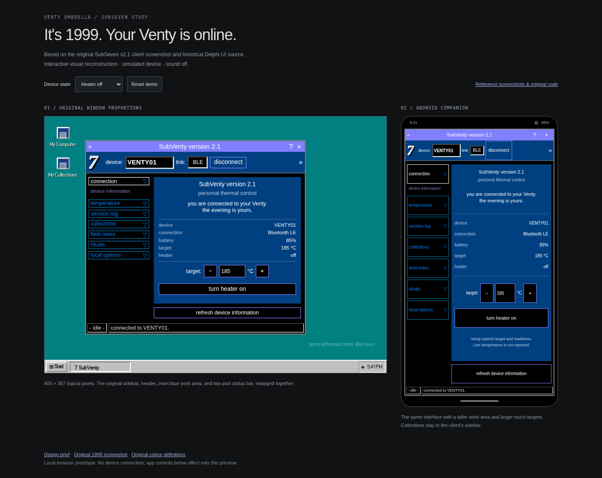

# SubVenty: original SubSeven interface study

The [native Android implementation](../../../README.md) is now available. This document describes the browser reference and its source research.

The [second native preview](../../native-preview/iteration2/README.md) follows the user's subsequent pair of SubSeven/Legacy screenshots: tree navigation, a charcoal workspace, a blue icon toolbar, an embossed S7 badge and square utility windows. Its palette and geometry are adaptations of those supplied images, not the exact 2.1.2 colour constants documented below. The original browser reconstruction remains unchanged.

[Open the reconstruction](index.html). Serve the repository root with `python3 -m http.server 8765`, then open `http://localhost:8765/docs/design-exploration/subventy/`.

## Reference edition and fidelity

The visual reference is **SubSeven 2.1, November 1999**. The adaptation preserves its lavender caption strip, silver 7 position, blue connection toolbar, black shell, cyan outlined sidebar buttons with downward arrows, inset blue work area, bottom action and two-part status bar. Venty functions replace the original commands. This is an independently written HTML/CSS/JavaScript reconstruction, not the original executable or a claim of pixel-identical assets.

The desktop client is 405 × 357 logical pixels, matching the adjacent historical form's `ClientWidth`/`ClientHeight`. It is enlarged as a whole for the comparison. Android keeps the layout structure, increases action sizes, and extends the blue work area vertically. It intentionally departs from original pixel dimensions for touch use. The silver 7 is recreated with styled text; the client uses Arial from the historical form declaration; the surrounding Windows-style desktop uses a bundled bitmap-style font replacement. Exact original branding art and the original proprietary Windows font are not included.

## Screenshot research

- [Malware Museum: SubSeven 1.0](https://www.malware.museum/release/subseven/10/): February 1999; inspected the original red-pane, multi-manager screenshot.
- [Malware Museum: SubSeven 1.9](https://www.malware.museum/release/subseven/19/): June 1999; inspected the blue/purple single-window screenshot.
- [Malware Museum: SubSeven 2.1](https://www.malware.museum/release/subseven/21/): November 1999; inspected the sidebar interface used as this study's reference.

Those screenshots establish that “original SubSeven” describes several different 1999 interfaces. The 2.1 layout is the chosen baseline here. Earlier screenshots remain linked so the exact remembered edition can be identified. Original screenshots were inspected as references and are not bundled in this repository.

## Actual GitHub source found

### Historical code: EgeBalci/sub7

[Repository](https://github.com/EgeBalci/sub7), inspected at commit `9eb25b7fa5fbeaacb3840543340feb3fb957d2e4`.

The [README](https://github.com/EgeBalci/sub7/blob/9eb25b7fa5fbeaacb3840543340feb3fb957d2e4/README.md) identifies the release as **2.1.2, April 2000**. It is actual historical source, but is not the November 1999 v2.1 release. This distinction matters when claiming an exact version match.

Useful UI files:

- [client/MainColors.pas](https://github.com/EgeBalci/sub7/blob/9eb25b7fa5fbeaacb3840543340feb3fb957d2e4/client/MainColors.pas): original named colour tokens and default values. Delphi TColor values use BGR ordering: caption `$00FF8080` becomes CSS `#8080ff`, foreground `$00804000` becomes `#004080`, menu text `$00FF8000` becomes `#0080ff`, and menu border `$00C08000` becomes `#0080c0`.
- [client/mainunit.dfm](https://github.com/EgeBalci/sub7/blob/9eb25b7fa5fbeaacb3840543340feb3fb957d2e4/client/mainunit.dfm): binary Delphi form resource. The TPF0 header contains the original 405 × 357 client geometry. Its top-level font is Arial at Font.Height = -12. It is a binary form, not UTF-16 text.
- `client/AddressBookUnit.dfm`, `client/AboutUnit.dfm`, and `client/uOutBar.dfm`: other original form resources located in the repository tree.

Only UI declarations/metadata were inspected. The Venty project contains an independent interface implementation with no imported runtime from this repository.

### Later remake: DarkCoderSc/SubSeven

[Repository](https://github.com/DarkCoderSc/SubSeven), inspected at commit `b2a64feb3e04f6130b62c3e59be72611c9017eee`.

Its [README](https://github.com/DarkCoderSc/SubSeven/blob/b2a64feb3e04f6130b62c3e59be72611c9017eee/README.md) describes a later remake of the **2.2.x** interface. Its `Viewer/VCL/` controls and `Viewer/Units/Forms/uFormMain.dfm` are useful secondary design references, but this is not original 1999 source. No code from that remake was imported.

## Mapping to the Venty companion

| Original UI slot | Venty adaptation |
| --- | --- |
| Address and port row | Selected device and BLE connection |
| Sidebar section buttons | Connection, temperature, local session log, collections, field notes, rituals, local options |
| Blue information panel | Target, readiness, battery, and deliberate heater actions |
| Text/list work areas | Private notes, Atlas, Ember Trail and weekly postcard |
| Local options | Do not track; existing collections preserved; no backfill |
| Bottom status strip | Device connection and explicit action acknowledgement |

The client shows **target** and **readiness**, not fabricated live temperature. Disconnected target/heater controls are disabled. Heating does not award stamps or add sessions in this prototype. Notes and settings are volatile preview state; they reset on reload. Postcards can be dismissed and reopened. Sounds remain off. Dialog and window close/reopen controls work. Collection and reward rules remain as defined in the main design brief.

Native implementation should translate the visual tokens and component geometry into Compose. Device command handlers remain the existing Venty handlers. Preserve the current device capability checks, presets, boost offsets, ramp controls and Volcano pump. Retain 48 dp touch targets and TalkBack semantics, while keeping the original compact desktop geometry available only as a visual reference. This study changes no Kotlin or BLE code.

## Assets and verification

The bundled `ms-sans-serif.woff2` replacement is from [98.css v0.1.21](https://github.com/jdan/98.css). Its MIT notice is in `FONT-LICENSE.txt`. All runtime assets are local; source links are opened only when clicked.

Browser verification covers target bounds and numeric validation, heater state, disconnect/reconnect, all seven sidebar sections, keyboard navigation, escaped note editing, pause preservation, postcard dismissal/reopen, About dialog, window close/reopen and responsive widths. Native/hardware builds and workflow runs are outside this design-only change.
