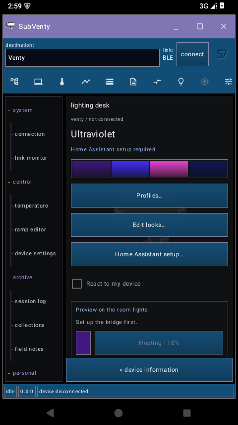
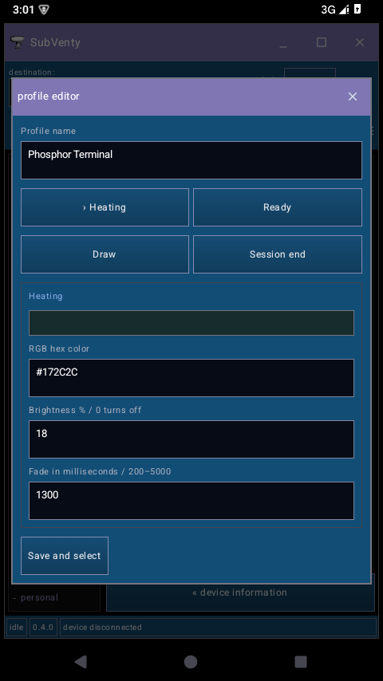

# SubVenty room lighting with Home Assistant

SubVenty sends lighting cues from your Android phone to a Home Assistant automation. That automation applies the look to the Govee light entities or light group you choose. Home Assistant owns the light selection, and SubVenty owns the profile.

| Lighting Desk in preview 4 | Profile editor in preview 4 |
| --- | --- |
|  |  |

## Set it up

1. In Home Assistant, open the Govee lights you want to use and verify you can set their color and brightness there. If they are missing, check whether your models support the [Govee lights local integration](https://www.home-assistant.io/integrations/govee_light_local/). You can select several lights or create a light group.
2. On your phone, install [SubVenty preview 6](https://github.com/thehillbeyondthisone/venty-android-umbrella/blob/builds/subventy-preview6/subventy-0.4.0-preview6.apk?raw=true). Connect your phone to the same network as the Pi.
3. Open **Settings → Lighting Desk**. Open **Home Assistant setup**. The address starts at `http://192.168.1.170:8123`. Use your actual port or HTTPS base address if yours differs. Copy the generated **Webhook ID** and tap **Save bridge**.
4. In Home Assistant, go to **Settings → Automations & scenes → Blueprints → Import blueprint** and paste the [blueprint URL](https://raw.githubusercontent.com/thehillbeyondthisone/venty-android-umbrella/design/visual-directions/docs/home-assistant/subventy-lighting.yaml). The setup window can copy this URL for you.
5. Create an automation from **SubVenty room lighting**. Paste the exact webhook ID, select your light entities or group, and save and enable it.
6. Back in **Lighting Desk**, tap **Draw** under **Preview on the room lights**. When the lights respond, turn on **React to my device** for automatic effects.

If SubVenty reports that it sent a preview but the lights stay unchanged, open the automation's **Traces**. A missing trace usually means Home Assistant did not match the webhook ID or the phone's source was not local. If the trace shows a light service error, check the selected light's color and brightness support. Fade support varies by Govee model and integration.

## Create and share looks

Choose **Ultraviolet**, **Phosphor Terminal**, or **Ember Afterglow** under **Profiles**. **Edit looks** offers separate color, brightness, and fade controls for *Heating*, *Ready*, *Draw*, and *Session end*. A brightness of zero turns the selected lights off. The default session-end look is a dim afterglow.

Save under a new name to keep another profile in your library. **Share current profile** opens the Android share sheet with the profile JSON. The recipient can paste it into **Profiles → Import profile**. The JSON carries only the name and visual settings. Each phone configures its own bridge, and each Home Assistant automation chooses its own light entities.

## What the bridge sends

Automatic changes use actual Bluetooth status from a connected device. On a Venty, SubVenty estimates draws from the automatic shutoff counter once the target has been reached. Lights switch to *Draw* when the counter rises and back to *Ready* when the counter falls. Firmware, polling cadence, network speed, and Govee command latency can affect the response. Volcano Hybrid uses heating, ready, and session end. Preview buttons work without a physical device.

The bridge starts with automatic lighting off. **Do not track** pauses automatic lighting as well as the existing session recording. Disabling automatic lighting or pausing leaves the lights at their last state. You can still preview a look explicitly. A session ending or its active Bluetooth connection dropping applies the profile's session-end look while the bridge remains enabled and reachable.

The blueprint accepts POST requests from the local network and only controls its configured light entities. Its webhook ID is the secret. Keep it out of shared profiles and generate a new ID in both places if you need to rotate it. The app permits HTTP to the Pi's configured default IP and to `homeassistant.local`. For other hosts, enter an HTTPS base URL with a certificate the phone trusts.

The Android 15 emulator installed preview 4 over preview 3, saved a bridge configuration and a named profile, and sent the expected Draw cue to a mock Home Assistant webhook. The actual Pi and Govee response need a local network test.
