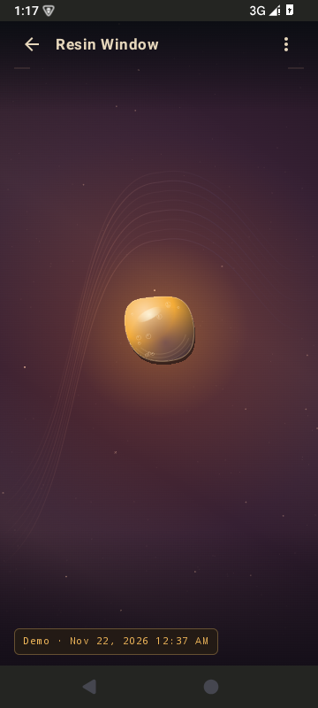
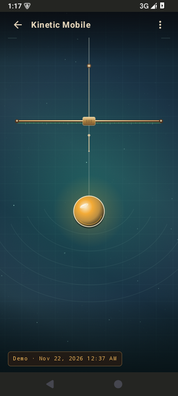

# SubVenty Preview 10

[Download the Android APK directly](https://raw.githubusercontent.com/thehillbeyondthisone/venty-android-umbrella/fdc7bb4484e50c126543be440efb41651b223726/subventy-0.4.0-preview10.apk) · [Download the ZIP and extract the APK](https://github.com/thehillbeyondthisone/venty-android-umbrella/archive/fdc7bb4484e50c126543be440efb41651b223726.zip)

**Device → Session objects** and **Archive → Draw sessions** use the full app area. Resin Window has layered translucent resin, internal bubbles and a warm refracted backdrop. Kinetic Mobile has a brass suspension rig, lit glass beads and a cool engraved backdrop. Sparse sessions give the pieces more room. Both scenes keep each piece’s shape as they adapt to a phone screen.

| Resin Window | Kinetic Mobile |
| --- | --- |
|  |  |

Tap a piece to inspect it. Pull a bead sideways and release to pluck it on Kinetic Mobile. Use **⋮** to switch scenes, see **By person**, or simulate a draw in Demo Venty. The live screen keeps seat selection and heater-off at the bottom.

The signed APK installed over Preview 9 on Android 15. At 360 dp, both scenes filled the width and used more than 600 dp of height between the header and lower controls. Tapping a piece opened its details, and pulling a bead made the mobile move without opening details. The debug build, 125 unit tests and Android lint passed. Both download links were checked against the signed build byte for byte.
