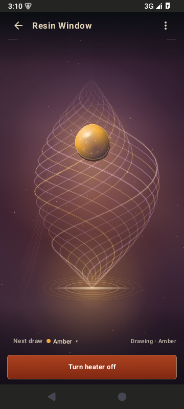
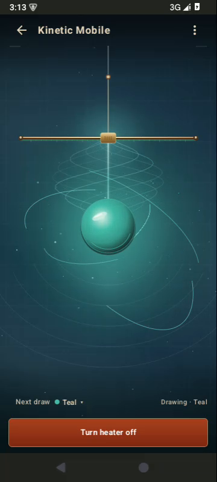

# SubVenty Preview 11

[Download the signed APK](https://raw.githubusercontent.com/thehillbeyondthisone/venty-android-umbrella/787dbd59a323eb6bbfdb76c2cdf146da7f92c203/subventy-0.4.0-preview11.apk) · [Download the ZIP and extract the APK](https://github.com/thehillbeyondthisone/venty-android-umbrella/archive/787dbd59a323eb6bbfdb76c2cdf146da7f92c203.zip)

In **Device → Session objects**, the art starts as soon as SubVenty detects a draw. **Resin Window** lights up with moving ribbons that surround a growing drop. **Kinetic Mobile** lights a filament from the rail to the forming glass, with arcs sweeping around the bead. When the draw ends, the light fades and the piece settles into the session. The assigned seat determines its color.

| Resin Window during a draw | Kinetic Mobile during a draw |
| --- | --- |
|  |  |
| [Watch the Resin Window clip](resin-live.gif) | [Watch the Kinetic Mobile clip](mobile-live.gif) |

To watch either scene without hardware, open Demo Venty, turn the heater on and wait for **Ready**. Open **Session objects**, choose a scene, then use **⋮ → Simulate draw**. Physical Venty draw edges come from the auto-shutoff timer estimate and can lag the breath.

Both samples were captured during actual Demo Venty events on the 360 dp Android 15 emulator. The debug build, 126 unit tests and Android lint passed. The direct download and fallback ZIP were both verified against the signed APK.
