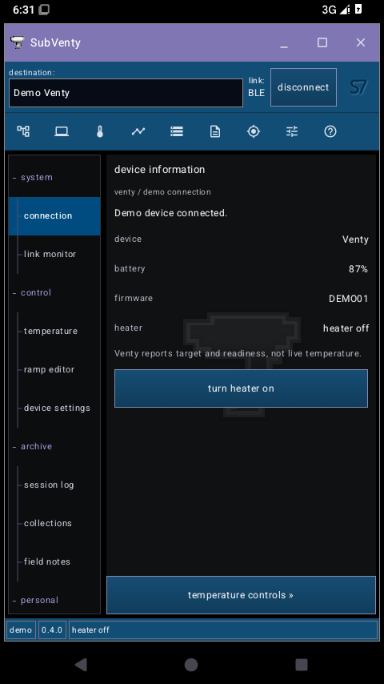
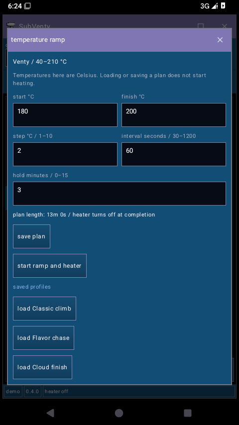
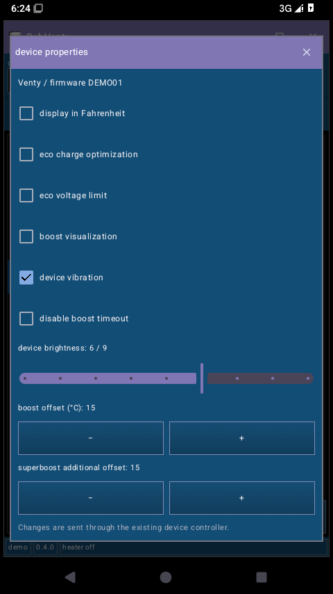
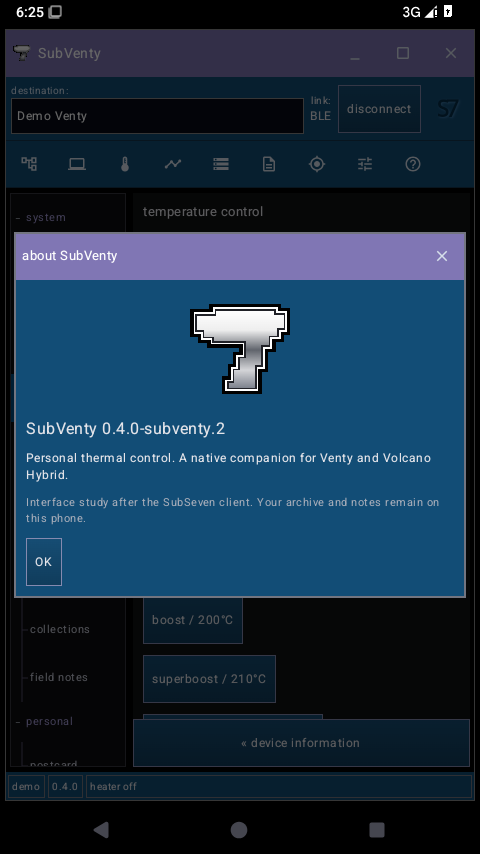

# Native SubVenty preview 2

[Download the APK](https://github.com/thehillbeyondthisone/venty-android-umbrella/blob/builds/subventy-preview2/subventy-0.4.0-preview2.apk?raw=true) · [APK and SHA-256 checksum](https://github.com/thehillbeyondthisone/venty-android-umbrella/tree/builds/subventy-preview2)

Version `0.4.0-subventy.2`, version code 10, package `io.github.thehillbeyondthisone.subventy`. The application ID and signing certificate match preview 1, so installing this APK updates it while preserving app data.

## Visual direction

This iteration follows the two user-supplied SubSeven references: a lavender caption, blue connection row and compact icon toolbar, black tree-navigation pane, charcoal workspace, embossed S7 badge, silver seven and square blue utility windows. It is an independent Compose implementation. The drawn emblem and icons are adaptations, not original bitmap assets. Touch targets remain at least 48 dp for the main controls; narrow screens and large font settings use the navigator window in place of the sidebar.

These are screenshots of the actual Android app on an Android 15 emulator, at a 480 × 854 display size, using the simulated Venty. No example collections are seeded into the app.

| Client workspace | Temperature ramp window |
| --- | --- |
|  |  |

| Device properties | About window |
| --- | --- |
|  |  |

Additional screenshots: [connection](connection.png), [temperature controls](temperature.png), [expanded workspace](expanded-workspace.png), [navigator](navigator.png), [local options](local-options.png).

## Functional additions

- Grouped, collapsible navigation tree and functional icon toolbar. Window controls minimize the app, hide/restore the sidebar, and offer to close the client window with the background-heating behavior explained.
- Ramp editor with start/finish, step, interval and hold fields; validation respects the connected device's range and the existing ramp limits. Saved profiles load into the draft. Saving/loading does not heat; starting requires the separate **start ramp and heater** action. Stopping a ramp leaves the heater setting unchanged, as stated in the window.
- Device properties for units, eco charging/voltage, boost visualization, vibration, boost timeout, brightness and boost offsets, subject to device capability. All commands use the existing controller.
- Find My window with lifecycle-aware RSSI polling and the existing vibration/flash action; link monitor showing controller events.
- Search by date or note, paginated archive rows, dedicated one-line note editor and JSON export through Android's save-file picker. Export is schema `subventy.archive`, version 1, and includes every device archive, demo records, notes and the paused preference. There is no import yet.
- Client options for keeping the display awake while heating, reached notifications, fork-update checks and idle disconnect.
- Existing Atlas, Ember Trail, postcard and Do not track behavior are preserved. The collection storage format and BLE protocol are unchanged in this iteration. The original advanced dashboard remains accessible under **legacy controls**.

## Verification

- `./gradlew :app:assembleDebug :app:testDebugUnitTest :app:lintDebug` succeeds with JDK 17 and Android SDK 36.
- **116 unit tests pass**, with zero failures/errors/skips. Six new ramp-draft tests cover invalid/incomplete/overflowing input, descending and out-of-range temperatures, device-specific limits, time/step limits and boundary values.
- Android lint completes with no errors; existing warnings remain.
- APK signing verifies. The preview 1 and preview 2 signing certificate SHA-256 digests match.
- The final APK installs as an update on the Android 15/API 35 emulator. Automated checks pass for demo connection without a redundant Bluetooth-permission prompt, target adjustment, heater on/off, toolbar/tree navigation, ramp/properties/About windows, sidebar expansion/restoration, local options and archive export.
- Screenshot inspection verifies the native window composition and the silver emblem. Physical BLE and real-phone ergonomics were not exercised by these emulator checks.

Builds and tests ran locally. No GitHub Actions workflow was dispatched and the manual-only triggers remain unchanged. The APK is on a separate build-artifact branch; no binary is added to the implementation branch.
