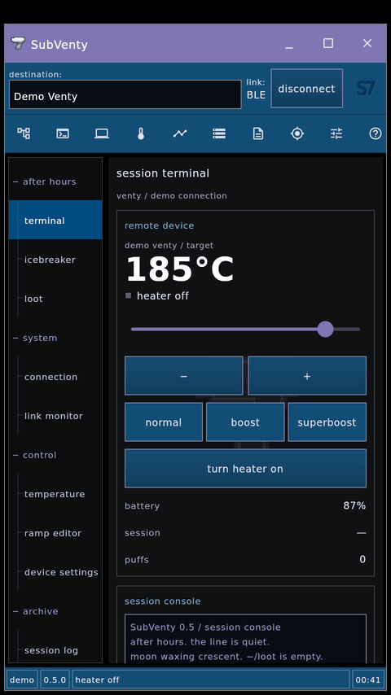
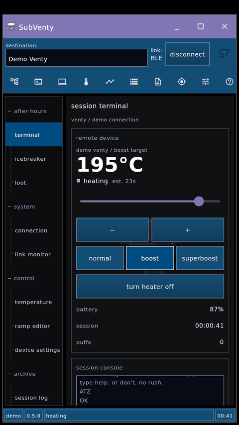
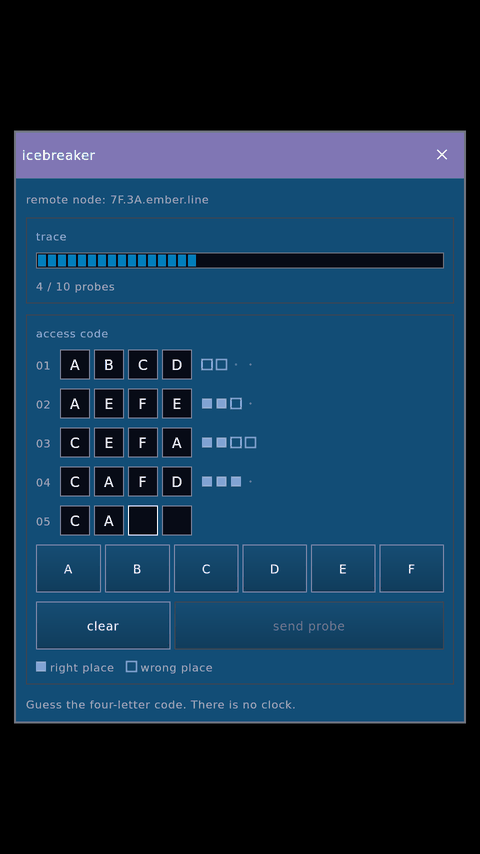
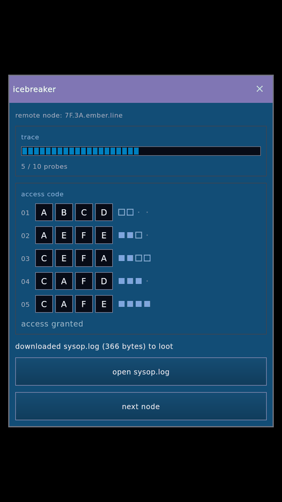
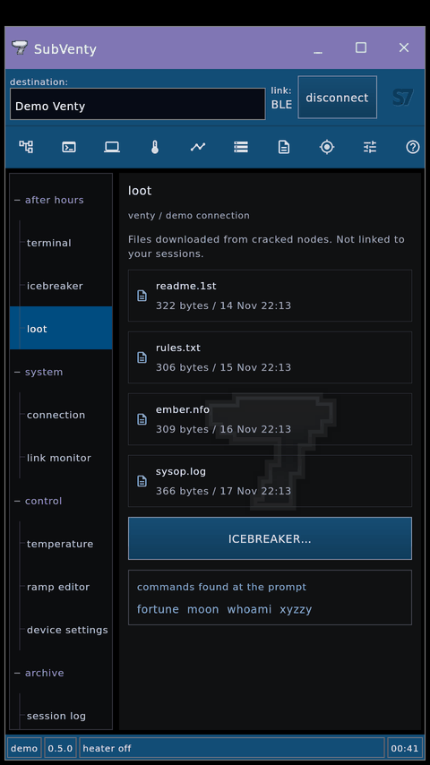
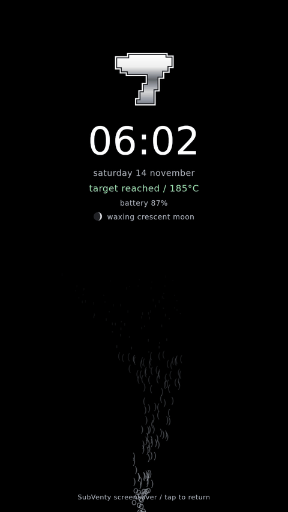

# SubVenty iteration 3: after hours, inside the SubSeven client

Version `0.5.0-subventy.3`, version code 11. **Source only so far: not yet built as an APK.** The renders below come from [`tools/night-preview`](../../../tools/night-preview), which compiles the new Compose surfaces against Compose for Desktop. They are not Android screenshots. The Android build, lint and emulator pass still need to run on a machine that can reach Google Maven.

## Direction

A midnight session as a 90s hacker, built **inside** the preview 2 SubSeven client rather than around it. The chrome is unchanged from preview 2: lavender caption, blue connection row and icon toolbar, tree navigation, charcoal workspace with the silver seven watermark, square utility windows and the segmented status strip. Its colours, geometry and fonts are the same `S7` tokens, traced in [SOURCES.md](../../design-exploration/subventy/SOURCES.md). New features use only those parts: `S7Group`, `S7Button`, `S7Input`'s dark well, `ArchiveRow` and `UtilityWindow`. The one new colour is the trace progress segments, the original menu border `$00C08000` from `MainColors.pas`.

An earlier draft of this iteration added a CRT, phosphor text and a VT323 font. That draft was removed because it departed from the SubSeven look.

## What's new

- **Session terminal** (new tree group *after hours*, toolbar terminal icon, default page). A **remote device** group holds the target readout with a status lamp, the target slider, ±, normal/boost/superboost, the heater button, the pump button on a Volcano, and battery, session time and puffs. A **session console** group holds a log list in the dark input well, a command line and a row of command buttons. Commands go through the existing controller, the same calls the buttons make.
- **Console narration** of device-confirmed changes: dial-up lines while connecting (`ATZ` / `OK` / `ATDT VENTY` / `CONNECT`), IRC-style joins and quits, the heater as a process (`> exec heat.exe --target 185°C`), and puffs as received packets.
- **ICEBREAKER** utility window. Guess a four-letter code (A–F), with right-place and wrong-place markers and ten probes on a 98-style segmented trace bar. Each crack downloads the next of 12 short text files from *The Ember Line*, a fictional 1999 BBS, into **loot**. The files open in a fixed-width viewer so their ASCII art lines up. About twenty hidden prompt commands (`whoami`, `fortune`, `xyzzy`, `sudo`, `+++`, `moon`…) are listed under loot once you find them.
- **Screensaver** after two idle minutes on the terminal: the silver seven, a clock, device state, battery and moon phase, over a thin rising plume of characters. Tap or press back to return. It can be turned off in local options.
- **Status strip** gains a clock segment. **Modem sound**: an optional synthesised handshake on connect, off by default (`modem on` at the prompt or local options).

### Guardrails from the design brief

- ICEBREAKER is untimed and works with or without a device. Nothing scores speed.
- Loot and found commands never come from sessions, puffs, temperatures or heat-ups, and they unlock no device features. They live in their own store, and **forget loot and found commands** clears only them. Loot lists only files you have; it shows no locked slots or totals.
- The readout shows the **target**. On a Venty, *target reached* appears only after the device reports it. The Volcano also shows its real live reading. The ETA is the existing estimate, labelled *est.*
- Sound is off unless enabled. There are no notifications, streaks or reminders. Reduced motion stops the plume and the heating dots.

## Renders

| Terminal | Heating in boost | ICEBREAKER |
| --- | --- | --- |
|  |  |  |

| Cracked: file downloaded | Loot | Screensaver |
| --- | --- | --- |
|  |  |  |

More: [target reached](03-terminal-reached.png), [Volcano](09-volcano.png), [file viewer](07-loot-reader.png).

## Terminal commands

```
status          heat [temp]     off            set <temp>
+ / - [n]       normal | boost | super         pump [on|off]
ramp [stop]     connect  disconnect  demo [volcano]  find
log  notes  atlas  loot  icebreaker  lock  settings  clear
handle <name>   modem <on|off>
```

Temperatures use the device's unit, or an explicit one: `heat 375f`, `set 190c`. Out-of-range targets are rejected, not clamped. `heat` with the heater already running leaves a boost alone.

## Code map

| File | What |
| --- | --- |
| `ui/subventy/TerminalModel.kt` | Pure Kotlin: command parser → `TermAction`s, console narration (`Feed`), MOTD, fortunes, moon phase |
| `ui/subventy/Icebreaker.kt` | Pure Kotlin: game rules, scoring, loot files and their encoding |
| `ui/subventy/TerminalHome.kt` | Terminal page, built from S7 components |
| `ui/subventy/NightPieces.kt` | ICEBREAKER window body, loot list and viewer, screensaver, segmented bar |
| `ui/subventy/NightTheme.kt` | Console tone colours and the reduced-motion flag (no new chrome) |
| `ui/subventy/NightStore.kt` | Android: handle, sound and screensaver prefs, downloaded loot, found commands, console scrollback |
| `ui/subventy/ModemSound.kt` | Android: synthesised handshake via `AudioTrack` (off by default) |
| `ui/subventy/SubVentyScreen.kt` | Wiring: terminal page, command dispatch, narration, screensaver timer, new windows, clock segment |

## Verification so far

- `./gradlew -p tools/night-preview test` passes **30 JVM tests**. They cover parsing, units and range rejection, capability gating, hidden commands staying out of `help`, macros, narration, battery thresholds, moon phases, ICEBREAKER scoring and rules, loot order and width, and the loot codec.
- `./gradlew -p tools/night-preview run` compiles the new surfaces and the chrome, and renders the PNGs above.
- **Not run:** the Android build, lint, the existing 116 app tests, and any emulator or device pass. `SubVentyScreen.kt`, `NightStore.kt`, `ModemSound.kt` and `VentyApp.kt` were reviewed but not compiled. Run `./gradlew :app:assembleDebug :app:testDebugUnitTest :app:lintDebug` before publishing preview 3.
