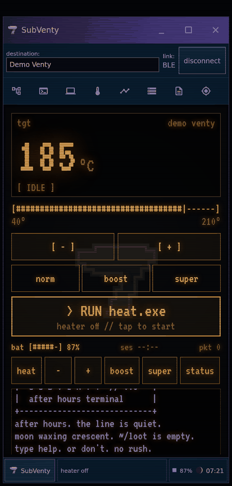
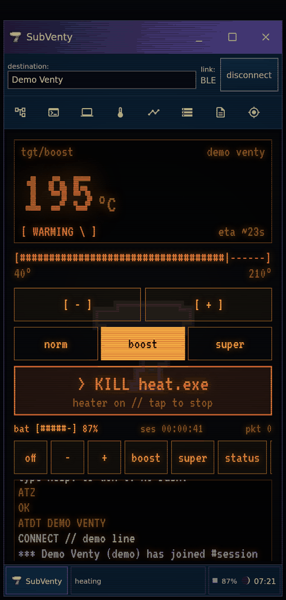
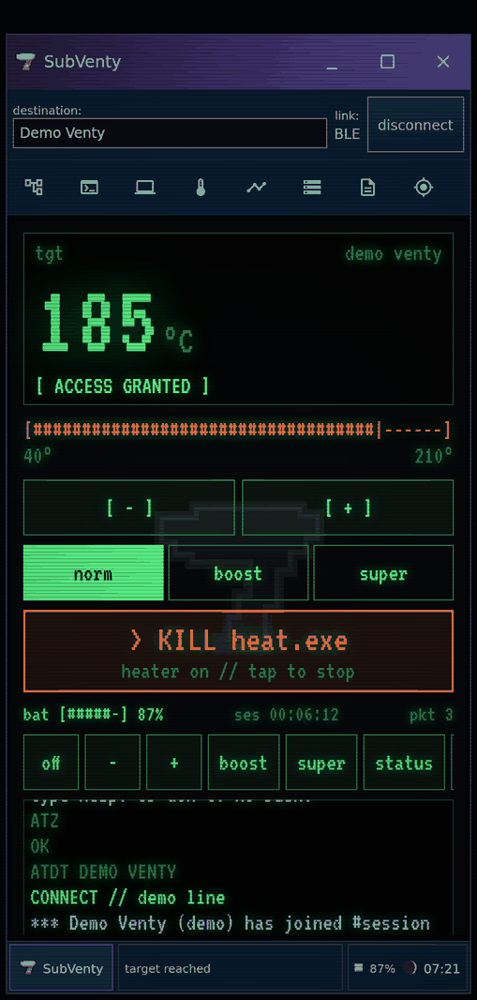
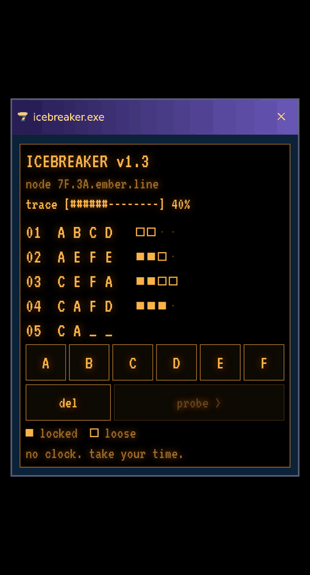
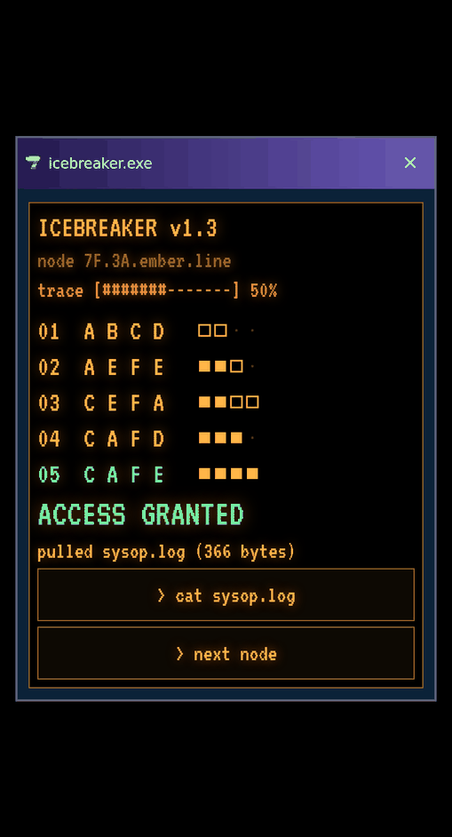
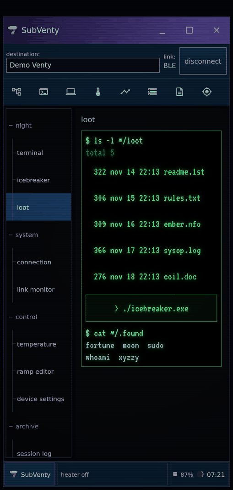
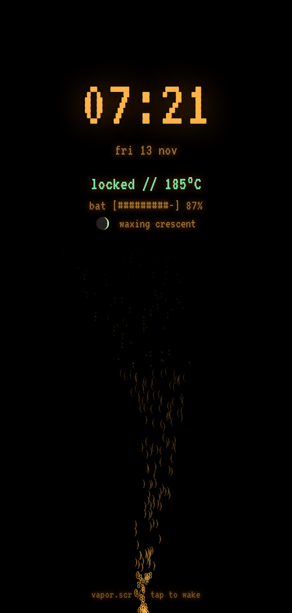
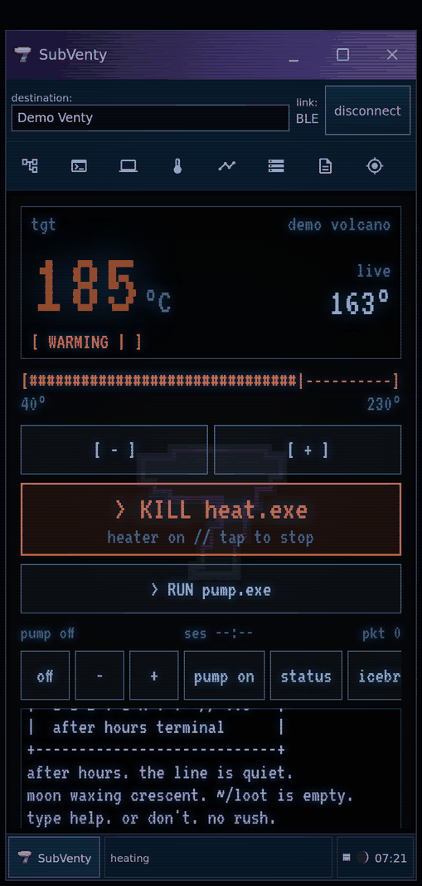
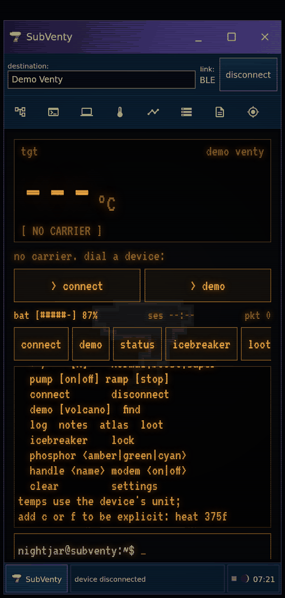

# SubVenty iteration 3: after hours

Version `0.5.0-subventy.3`, version code 11. **Source only so far: not yet built as an APK.** The renders below come from [`tools/night-preview`](../../../tools/night-preview), which compiles the new Compose surfaces against Compose for Desktop. They are not Android screenshots. The Android build, lint and emulator pass still need to run on a machine that can reach Google Maven.

## The direction

A midnight session as a 90s hacker: the SubSeven client from preview 2, running on a CRT in a dark room.

- **Form.** Everything moves to a night palette: a deep violet → lavender 98-style gradient caption, a navy panel and a near-black workspace. Scanlines, a vignette and a faint refresh band roll over the whole client. Terminal text uses a phosphor colour you pick: amber by default, plus green or cyan. The one warm light in the room is the heater. It glows orange while warming and turns green when the device confirms it has reached the target.
- **Utility.** A new terminal page is home. It has a big target readout, an ASCII fader (`[#####|----]`, draggable, with TalkBack range semantics), ±1° keys, mode tabs and a `> RUN heat.exe` / `> KILL heat.exe` heater button. Below those are battery, session clock and puffs (shown as "packets"), plus one-tap macro chips. Every command goes through the existing controller with the same calls as the buttons. A 98-style taskbar replaces the status strip and shows the notice, link state, battery, moon phase and clock.
- **Nostalgia.** Connecting reads as a dial-up (`ATZ` / `OK` / `ATDT VENTY` / `CONNECT`). Joins and drops look like IRC (`*** Venty has joined #session`). The heater shows as a process (`> exec heat.exe --target 185°C`). An optional synthesised modem handshake can play on connect; it is **off by default**. After two idle minutes on the terminal, `vapor.scr` shows a nightstand clock with an ASCII vapour plume. Tap or press back to wake it.
- **Game.** **ICEBREAKER** is a four-glyph code-cracking puzzle (Mastermind-style, A–F, 10 attempts, a trace meter). Each crack pulls the next text file from *The Ember Line*, a fictional 1999 one-node BBS. The files tell a small story about its sysop, nightjar, and its callers, and they appear in `~/loot`. About twenty commands are hidden at the prompt (`whoami`, `fortune`, `xyzzy`, `sudo`, `+++`, `moon`…). `help` never lists them, and they are recorded only once you find them.

### Guardrails from the design brief

The game layer is deliberately separate from device use:

- ICEBREAKER is untimed and playable at any time, connected or not. Nothing scores speed. The trace meter counts attempts, not seconds.
- Loot and found commands are never derived from sessions, puffs, temperatures or heat-ups, and they never unlock device features. They live in their own store (`subventy_night`), apart from sessions and collections. **Forget loot and found commands** clears only them.
- `~/loot` lists only files already pulled. It shows no locked slots and no "3/12".
- The terminal shows the **target**, never a made-up temperature. On a Venty the digits are the setpoint, and `ACCESS GRANTED` appears only after the device reports reached. A short decrypt flourish plays at that point. The Volcano also shows its real live reading. The ETA is the existing estimate, labelled `eta ~`.
- Sound stays off unless you turn on the modem speaker. There are no notifications, streaks or reminders. Reduced motion (system animator scale 0) stops the flicker, roll, spinner, scramble and vapour drift.

## Renders

| Terminal, heater off | Warming in boost | Locked, green phosphor |
| --- | --- | --- |
|  |  |  |

| ICEBREAKER | Cracked: a file is pulled | `~/loot` |
| --- | --- | --- |
|  |  |  |

| vapor.scr | Volcano, cyan phosphor | No carrier + help |
| --- | --- | --- |
|  |  |  |

More: [ember.nfo in the reader](08-loot-reader.png), [help, fortune and sudo](11-help-fortune.png).

## Terminal commands

```
status          heat [temp]     off            set <temp>
+ / - [n]       normal | boost | super         pump [on|off]
ramp [stop]     connect  disconnect  demo [volcano]  find
log  notes  atlas  loot  icebreaker  lock  settings  clear
phosphor <amber|green|cyan>     handle <name>  modem <on|off>
```

Temperatures use the device's unit, or an explicit one: `heat 375f`, `set 190c`. Out-of-range targets are rejected, not clamped. `heat` with the heater already running leaves a boost alone.

## Code map

| File | What |
| --- | --- |
| `ui/subventy/TerminalModel.kt` | Pure Kotlin: command parser → `TermAction`s, the event feed (`Feed.diff`, collapse-by-key), MOTD, fortunes, moon phase |
| `ui/subventy/Icebreaker.kt` | Pure Kotlin: game rules, scoring, loot files and their encoding |
| `ui/subventy/NightTheme.kt` | Phosphor palette, night chrome tokens, CRT glass, terminal text |
| `ui/subventy/TerminalHome.kt` | Terminal home composables (readout, fader, modes, run button, console, prompt, macros, moon) |
| `ui/subventy/NightPieces.kt` | Taskbar, vapor.scr, ICEBREAKER window body, loot listing and reader |
| `ui/subventy/NightStore.kt` | Android: handle/phosphor/sound/screensaver prefs, pulled loot, found commands, in-memory scrollback |
| `ui/subventy/ModemSound.kt` | Android: synthesised handshake via `AudioTrack` (off by default) |
| `ui/subventy/SubVentyScreen.kt` | Wiring: terminal is the default page, command → controller dispatch, feed collection, screensaver idle timer, new windows |
| `res/font/vt323.ttf` | VT323, SIL OFL ([license](../../../third_party/vt323/OFL.txt)). It has no box-drawing glyphs, so all art is plain ASCII and the moon and pegs are drawn on a Canvas |

## Verification so far

- `./gradlew -p tools/night-preview test` passes **30 new JVM tests**. They cover command parsing, unit handling and range rejection, capability gating, hidden commands staying out of `help`, handle sanitising, macro validity, feed narration, collapse and bounds, battery thresholds, moon phases, ICEBREAKER scoring edge cases, trace and crack rules, loot order, the 32-column file width and the loot codec.
- `./gradlew -p tools/night-preview run` compiles every new Compose surface plus the re-paletted chrome, and renders the PNGs above.
- **Not run:** the Android Gradle build, Android lint, the existing 116 app tests and any emulator or device pass. `SubVentyScreen.kt`, `NightStore.kt`, `ModemSound.kt` and the `VentyApp` change were checked by review only. Build and test with Android Studio, or `./gradlew :app:assembleDebug :app:testDebugUnitTest :app:lintDebug`, before publishing preview 3.
