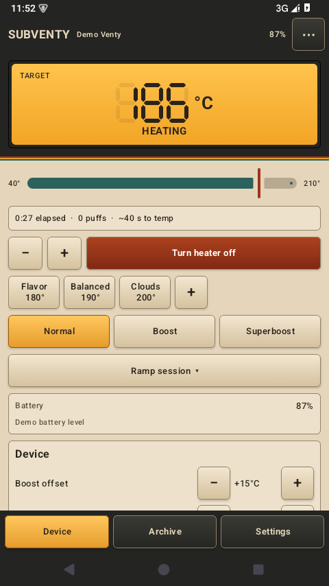
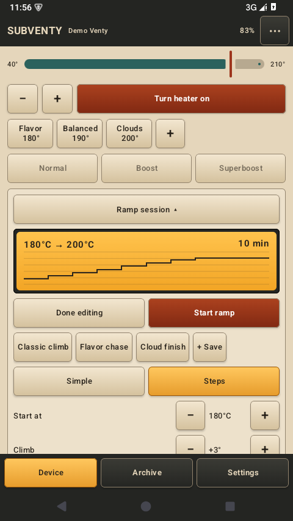
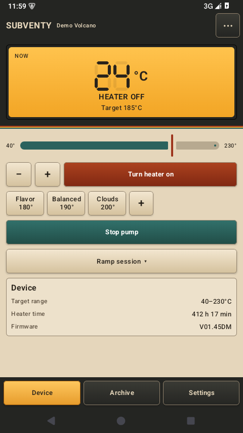

# SubVenty preview 5

[Download the Android APK](https://github.com/thehillbeyondthisone/venty-android-umbrella/blob/builds/subventy-preview5/subventy-0.4.0-preview5.apk?raw=true)

This build turns the cassette-future mockups into a native Compose dashboard. The Venty LCD shows its target and readiness. Volcano Hybrid shows an available live reading, a separate target and a pump key.

| Venty demo dashboard | Steps ramp editor | Volcano demo dashboard |
| --- | --- | --- |
|  |  |  |

The Device tab scrolls from target, presets and heater controls to Simple and Steps ramps, battery history, boost offsets, heater time and firmware. Long-press a preset or ramp profile to remove it and use **Undo** to restore it. On Venty, the mode keys are available while the heater is on. The Archive tab contains the collection views and history. **Settings → Lighting Desk** opens Home Assistant options.

Use **Stop ramp** to end the schedule while leaving the heater setting in place. Use **Turn heater off** to cancel the ramp and send the existing heater-off command.

The debug APK, 115 unit tests and Android lint pass. The published download matches the local build and its signing certificate matches the earlier previews. It installed over preview 4 on Android 15 and kept the archive and lighting profile. The Venty demo raised the target from 185 °C to 186 °C, turned on the heater, changed the ramp climb from 2 °C to 3 °C, and exercised ramp start, ramp stop and heater off. The Volcano demo showed separate live and target readings and passed the pump check. The emulator opened Archive and reached Lighting Desk through Settings. Hardware BLE remains untested.
