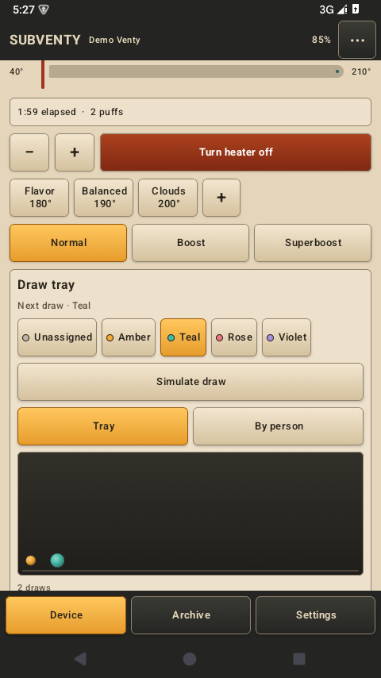
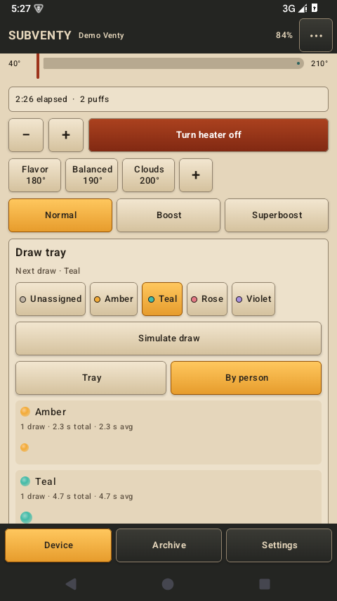

# SubVenty preview 6

[Download the Android APK](https://github.com/thehillbeyondthisone/venty-android-umbrella/blob/builds/subventy-preview6/subventy-0.4.0-preview6.apk?raw=true)

Scroll to **Draw tray** on the Venty Device screen. Pick a seat before drawing. A ball takes the color selected when the draw begins, grows with elapsed time, and drops into the well when the detector sees it end. You can change the selection while a ball is growing to prepare the next draw.

| Tray | By person |
| --- | --- |
|  |  |

**Tray** shows the latest 18 draws in order. **By person** shows one row per seat with all its balls, count, total and average duration. Groups stay in seat order. **Archive → Draw sessions** opens both views for completed sessions. JSON export includes the seat and duration for each recorded ball.

Venty infers draws from the shutoff timer, so ball sizes reflect estimates. Nearby timer resets on the same seat can extend the same ball. An observed new draw after a seat change gets a separate ball. Heater-off or disconnect saves the measurements that finished. **Do not track** pauses the tray and clears its in-progress data.

Demo Venty has a **Simulate draw** key once ready. The screenshots above were captured in the Android 15 emulator after two simulated draws. The session archive retained Amber at 2.3 seconds and Teal at 4.7 seconds. The debug build, 120 unit tests and Android lint pass. The APK installed over preview 5 and the published file matches the local build. Physical draw timing remains to be checked.
