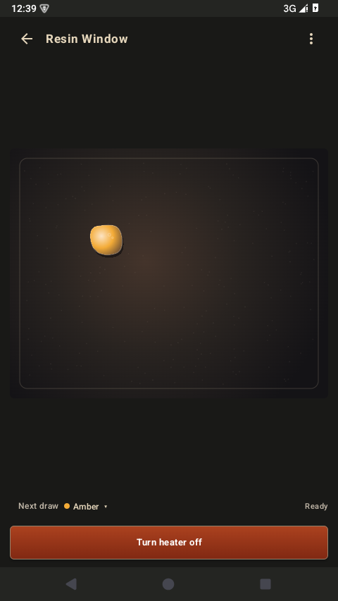
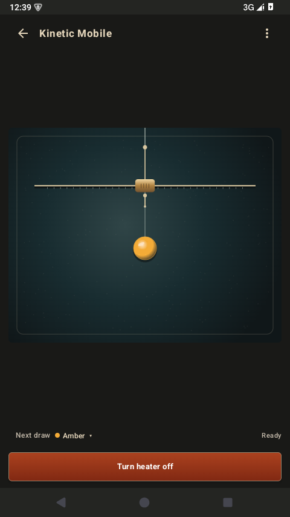

# SubVenty preview 8

[Download the Android APK](https://github.com/thehillbeyondthisone/venty-android-umbrella/blob/builds/subventy-preview8/subventy-0.4.0-preview8.apk?raw=true)

**Device → Session objects** opens a focused view of the sculpture. The back arrow returns to Device. **Next draw** sits within reach at the bottom, with **Turn heater off** below it while the heater is running.

| Resin Window | Kinetic Mobile |
| --- | --- |
|  |  |

Open **⋮** to switch between Resin Window and Kinetic Mobile, browse recorded draws, or see **By person**. In Demo Venty, **Simulate draw** appears in the same menu once the device is ready.

Tap a piece to see its duration and replay the draw. On Kinetic Mobile, pull a bead sideways and release to pluck it. **Draw details** also offers a **Pluck** button. Run the same views from **Archive → Draw sessions** for completed sessions.

Preview 8 uses the same application ID and signing certificate as preview 7. The debug build, 123 unit tests and Android lint pass.

On the Android 15 emulator, preview 8 installed over preview 7. A recorded demo draw rendered in both views. Tapping its bead opened duration, replay and pluck controls. The session menu opened per-person stats, and the heater-off key stayed within reach. The published APK matches the signed local build.
