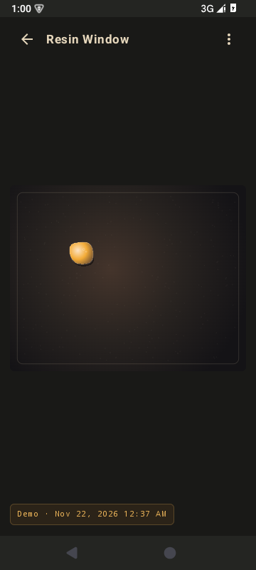
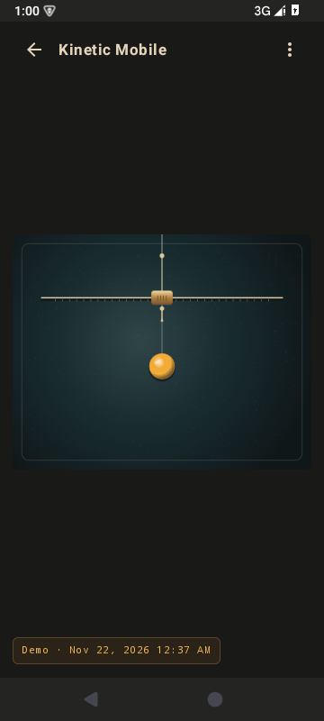

# SubVenty preview 9

[Download the Preview 9 APK directly](https://raw.githubusercontent.com/thehillbeyondthisone/venty-android-umbrella/refs/heads/builds/subventy-preview9/subventy-0.4.0-preview9.apk) · [Current preview](../iteration10/README.md)

**Archive → Draw sessions** opens saved sculptures in a dedicated viewer. The graphite screen gives the sculpture center stage and shows the session date in a small amber readout. Use **⋮** to switch sculpture, browse draws, or open **By person**. Tap a piece to inspect it.

| Saved Resin Window | Saved Kinetic Mobile |
| --- | --- |
|  |  |

Use the back arrow or Android Back to return to the Draw sessions list. Device filtering and list navigation live on that screen.

Preview 9 installed over Preview 8 on the Android 15 emulator. At 360 dp, a saved demo session opened in both sculptures and **By person**. Both Back actions returned to the filtered list. The debug build, 123 unit tests and Android lint passed. The published APK matches the signed local build.
